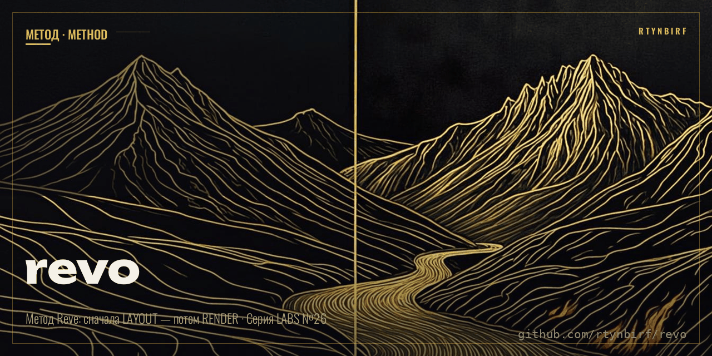

# REVO — автономный прототип метода Reve: layout → render


[](https://github.com/rtynbirf/revo/actions/workflows/ci.yml)
[](https://github.com/rtynbirf/revo/actions/workflows/auto-pilot.yml)


**REVO** (REnder-Via-layout-Orchestrator) — runnable-прототип метода **Reve «The Layout Bet»**:
сцена собирается не «промптом-лотереей», а в два этапа — сначала **структура** (layout: зоны,
координаты, свет, палитра), потом **рендер**, детерминированно собранный из структуры.

**v2 — АВТОНОМНЫЙ И САМОДОСТАТОЧНЫЙ**: сам составляет лейаут по тексту задания, сам рендерит,
сам себя критикует по зонам, сам чинит слабые места и сам публикует кадры из CI — каждый день,
без человека, без ключей, без сети.

**M2+M3 (2026-11-09)**: локальный сервер на чистом stdlib + веб-редактор лейаута (SPA без сборки)
— `python3 revo_server.py --port 8400` и весь продукт живёт в одном процессе без сети; вердикты
парити с оригиналом — [docs/PARITY.md](docs/PARITY.md).

---

## Автономия: два яруса, никогда не застревает

| Ярус | Мозг (задание→layout) | Глаза (критика) | Рендер | Что нужно |
|---|---|---|---|---|
| **1** — если есть `z-ai` | LLM (`z-ai chat`) | зон-критик + LLM-рефайн промпта | `z-ai image` | CLI в PATH |
| **0** — всегда, offline | встроенный композитор 8 архетипов | свой зон-критик (PIL-анализ: цвет/детальность/свечение по каждой зоне) | детерминированный вектор | только Pillow |

Ярус определяется сам (`detect_backend`). Ни один путь не требует внешних сервисов:
критик — свой (mean-RGB/детальность/яркость по bbox каждой зоны, score 0..10, вердикты),
рефайн offline — усиление слабых зон (цвет → primary, включение свечения) с повторным рендером.

## Цикл AUTO-PILOT (клетка в CI)

```
cron 04:21 UTC → selftest → задание из tasks/queue.txt (rotate по дню года)
  → compose (мозг) → skeleton → render → critic (score)
  → score < 7.5? → рефайн слабых зон → снова (до 3 попыток, лучшая — в архив)
  → autolog (AUTO-LOG.md из __run.json) → commit [skip ci]
```

Очередь пуста? Клетка **придумывает задание сама** из паттерн-библиотеки (`next_task`).
Пустых коммитов нет (анти-шум). Каждый кадр: `demo/auto/<дата>/` + строка в **[AUTO-LOG.md](AUTO-LOG.md)**.

## Быстрый старт

```bash
pip install -r requirements.txt     # = pillow

python3 revo.py selftest                       # 12 проверок ядра и сервера
python3 revo.py auto "караоке клуб, неон"      # полный автономный цикл
python3 revo.py patterns                       # библиотека архетипов
python3 revo.py compose "ночной город" -o l.json   # только мозг → layout.json
python3 revo.py pipeline layouts/datacenter.json --outdir demo/datacenter -b zai  # v1-режим тоже жив
python3 revo_server.py --port 8400             # M2+M3: сервер + веб-редактор → http://127.0.0.1:8400
bash tests/smoke_api.sh                        # смоук REST API (18 проверок)
```

## Библиотека архетипов (мозг ЯРУСА 0)

`datacenter` · `karaoke` · `cyber-city` · `cozy-room` · `mountains` · `studio` · `space` · `cabin`
— каждая: палитра, свет, точка схода, 4–6 зон с глубинами far/mid/near. `revo.py patterns -t "текст задания"` покажет, что выберет мозг и почему (keyword-скоринг RU+EN, при нуле — детерминированный поворот по хэшу).

## Критик-глаза (свой, объяснимый)

По каждой зоне: близость среднего цвета к **ожидаемому** (цвет элемента, растворённый в фоне
по глубине), детальность (σ яркости), бонус за свечение ярче фона. Итог — взвешенная оценка
0..10 (near ×1.2, mid ×1.0, far ×0.8), порог приёмки 7.5. Вердикты конкретные: какая зона,
что ждали, что получили. Проверено живым прогоном: караоке-сцена с 1-й попытки 7.5-не-дала —
агент усилил зоны и прошёл со 2-й.

## Пайплайн (ядро v1 — без изменений)

```
layout.json ──► [1] СКЕЛЕТ      рамки зон, подписи, точка схода
                [2] ПРОМПТ      детерминированный, ИЗ структуры
                [3] РЕНДЕР      offline (вектор) / zai (генерация)
                [4] СКЛЕЙКА     «было → стало» одним кадром
```

Готовые сцены: `layouts/datacenter.json` (из архива Reve), `layouts/karaoke-stage.json`.
Демо обоих бэкендов: `demo/datacenter/`, `demo/karaoke-stage/`.

## Честный статус

- ✅ v2 автономия: compose → render → критик → рефайн → autolog; selftest **12/12** (ядро + сервер);
- ✅ M2 сервер: `revo_server.py` только stdlib — REST + раздача UI, смоук **18/0**;
- ✅ M3 веб-редактор: `app/` (SPA без сборки, file://-демо) — живая браузерная приёмка end-to-end,
  ноль ошибок консоли, скриншоты `demo/ui/`;
- ✅ `docs/PARITY.md`: 12/12 вердиктов парити (**4 ✅ / 5 🔶 / 3 ⛔**);
- ✅ AUTO-PILOT в CI: ежедневный прогон offline, самокоммит, анти-шум;
- ✅ v1 ядро (skeleton/prompt/render/merge) не тронуто — обратная совместимость;
- 🔶 честно не готово: диф-подсветка зон при NL-инструкции и проекты/история версий — M4 (F-21 частично);
- ⚙️ LLM-мозг (ЯРУС 1) и VLM-глаза — опциональные усиления; без них всё работает offline;
- 🖐 social-preview в настройках репо — только руками в UI (GitHub API это запрещает).

## Восстановление app.reve.com (главная миссия репо)

Оригинал закрыт: генерация остановлена 27.09.2026, вход в аккаунты — 31.10.2026 (источники в ТЗ).
Издан полный комплект реставрации для агентов роя:

| Документ | Что внутри |
|---|---|
| [SPEC.md](SPEC.md) — ТЗ | хроника смерти с проверенными датами и источниками · честное определение «100%» · 28 требований F-xx с приёмкой · роли агентов |
| [ROADMAP.md](ROADMAP.md) | фазы M0✅ · M1✅ · M1.5✅ · M2✅ сервер · M3✅ UI-редактор → M4 проекты → M5🔶 парити → M6 |
| [docs/RESTORE-APP.md](docs/RESTORE-APP.md) | карта поверхностей оригинала · Wayback-указатели (снапшоты 05.11 и 28.10.2026) · целевые экраны · чеклист парити |
| [docs/ARCHITECTURE.md](docs/ARCHITECTURE.md) | слои, потоки, каталоги, нерушимые контракты |
| [docs/FORMAT.md](docs/FORMAT.md) | layout.json v1 — зеркальная спека валидатора |
| [docs/API.md](docs/API.md) | CLI-контракт (живое) + HTTP-контракт M2 v1.1 (реализован, смоук 18/0) + схемы отчётов |
| [docs/PARITY.md](docs/PARITY.md) | вердикт по каждому из 12 пунктов парити с app.reve.com: что восстановлено, что честно нет |

Ядро метода уже исполняемо: layout→render, критик, рефайн, CI-клетка ежедневно доказывает
живость кадром. Веса моделей оригинала публично не существуют — у нас подключаемые бэкенды
и offline-first: система работает без сети и ключей.

## Связи во вселенной

[`polymath-gen`](https://github.com/rtynbirf/polymath-gen) — старший медиа-агент (планировщик,
критик, эволюция) · [`rtynbirf/rtynbirf`](https://github.com/rtynbirf/rtynbirf) → `cells/` — идеи
клетками · [`polimat-hub`](https://github.com/rtynbirf/polimat-hub) — место сверок роя
(TODO/КОСЯКИ/ОТЧЁТЫ).

---
*REVO · серия RTYNBIRF LABS №26 · MIT · v2 автономия + M2 сервер + M3 редактор, 2026-11-09. Сначала структура — потом картинка. Сам.*
